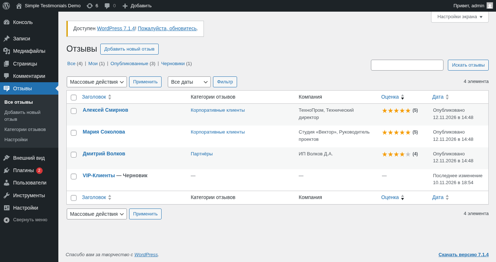
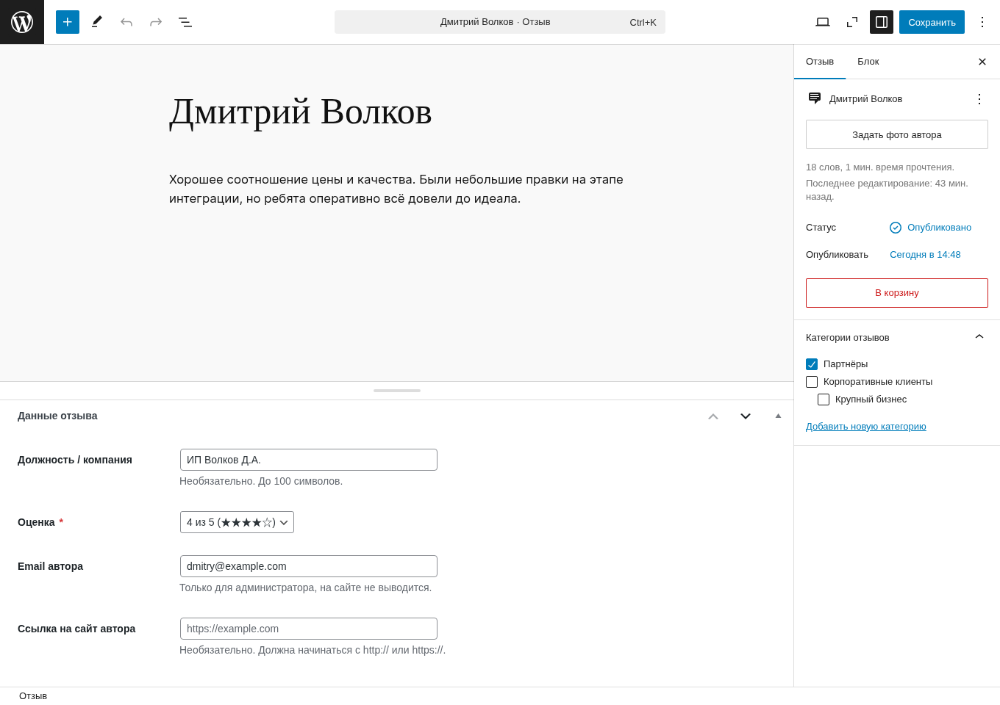
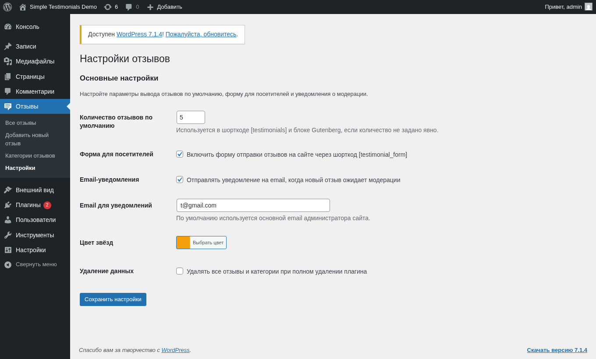
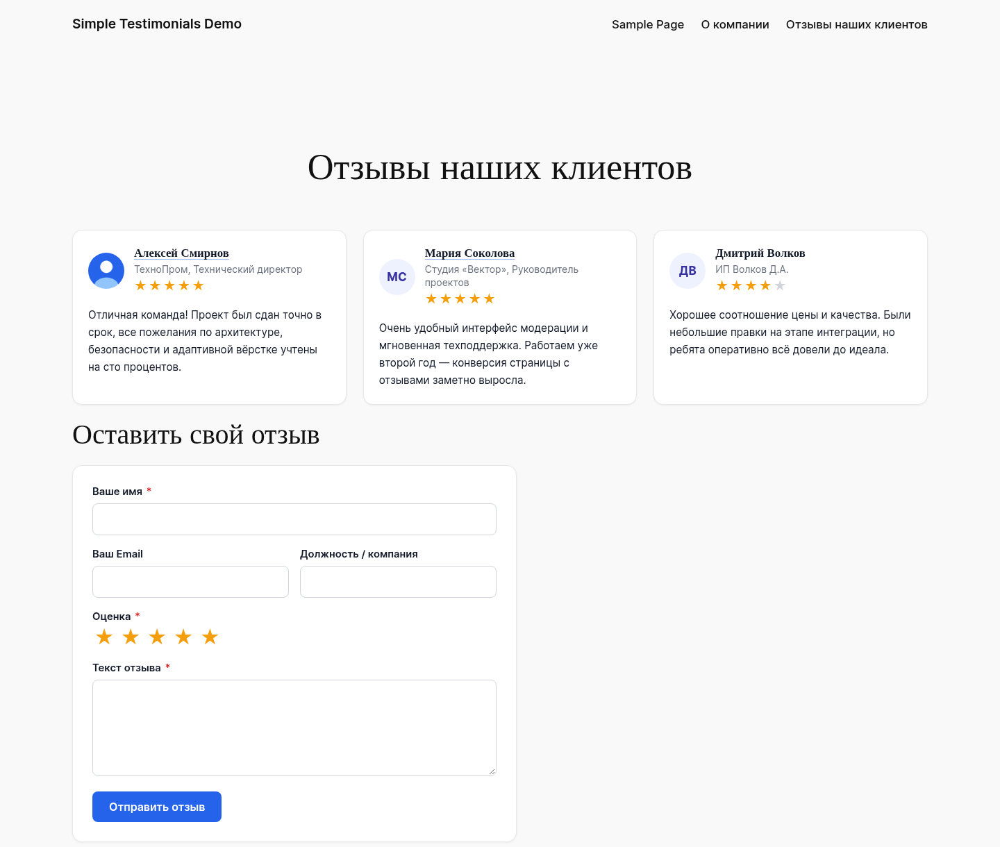

# Simple Testimonials — WordPress-плагин «Отзывы клиентов»

Лёгкий, безопасный и расширяемый плагин WordPress для управления отзывами клиентов. Позволяет администратору добавлять и модерировать отзывы с оценками и категориями, выводить их на сайте с помощью шорткода `[testimonials]` или динамического блока Gutenberg `simple-testimonials/list`, а также принимать новые отзывы от посетителей через AJAX-форму `[testimonial_form]` без перезагрузки страницы и без использования jQuery.

---

## Требования к окружению

- **WordPress:** 6.6+ (протестировано на WordPress 6.6 и 6.7)
- **PHP:** 8.1+
- **СУБД:** MySQL 8.0+ / MariaDB 10.6+
- **Совместимость с темами:** полная поддержка блочных (FSE) и классических тем, включая **Twenty Twenty-Four** и **Twenty Twenty-Five**.

---

## Установка

### Способ 1. Через панель администратора WordPress (ZIP-архив)
1. Перейдите в консоль WordPress: **Плагины → Добавить новый плагин → Загрузить плагин**.
2. Выберите установочный архив `simple-testimonials.zip` и нажмите **Установить**.
3. Нажмите **Активировать плагин**.

### Способ 2. Ручная установка в каталог плагинов
1. Скопируйте папку `simple-testimonials` в директорию `wp-content/plugins/`.
2. Перейдите в раздел **Плагины** в консоли WordPress и активируйте **Simple Testimonials**.

---

## Функциональные возможности и шорткоды

### 1. Тип записи «Отзыв» и таксономия
- Кастомный тип записи `testimonial` (раздел **Отзывы** в меню админ-панели с иконкой `dashicons-testimonial`).
- Поддержка имени автора (`title`), текста отзыва (`editor`), фото автора (`thumbnail`) и REST API / редактора блоков.
- Иерархическая таксономия `testimonial_category` (**Категории отзывов**).
- Метабокс **«Данные отзыва»** (метаполя с префиксом `_st_`):
  - `_st_company` — должность / компания (необязательное, до 100 символов);
  - `_st_rating` — оценка от `1` до `5` (обязательное поле);
  - `_st_email` — email автора (валидация формата, виден только администратору и никогда не выводится на сайте);
  - `_st_url` — ссылка на сайт автора (валидация `http://` и `https://`).
- В таблице отзывов добавлены колонки **«Компания»** и сортируемая колонка **«Оценка»**.

### 2. Шорткод вывода отзывов `[testimonials]`

Выводит опубликованные отзывы в виде адаптивных карточек (фото автора или круглая заглушка с инициалами, имя со ссылкой на сайт при наличии URL, должность/компания, звёзды оценки, текст отзыва). Фронтенд-стили (`public/css/frontend.css`) подключаются **только на тех страницах**, где присутствует шорткод или блок.

| Атрибут | По умолчанию | Допустимые значения | Описание |
| :--- | :--- | :--- | :--- |
| `count` | Из настроек (`5`) | Число `1–100` | Количество выводимых отзывов |
| `category` | Все категории (`""`) | `slug` категории (или несколько через запятую) | Фильтр по таксономии `testimonial_category` |
| `min_rating` | `1` | `1`, `2`, `3`, `4`, `5` | Минимальная оценка отзыва |
| `layout` | `grid` | `grid`, `list` | Макет отображения: адаптивная сетка или список |
| `orderby` | `date` | `date`, `rating`, `rand` | Сортировка: по дате, по оценке или случайно |

**Примеры использования:**
```text
[testimonials]
[testimonials count="6" category="clients" min_rating="4" layout="grid" orderby="rating"]
[testimonials count="3" layout="list" orderby="rand"]
```

### 3. Динамический блок Gutenberg `simple-testimonials/list`
- Блок **«Отзывы»** доступен в категории «Виджеты» редактора блоков.
- Рендерится на сервере через общий метод `ST_Shortcode::render_testimonials()`, формируя идентичную шорткоду разметку.
- В боковой панели настроек (`InspectorControls`) доступны все параметры: количество отзывов (с подстановкой значения по умолчанию из настроек плагина), выбор категории из списка существующих терминов или ввод `slug`, минимальная оценка, макет (`grid` / `list`) и сортировка (`date` / `rating` / `rand`).

### 4. Форма для посетителей `[testimonial_form]`
- Выводит форму отправки отзыва: имя, email, должность / компания, интерактивный выбор оценки звёздами (1–5) и текст отзыва.
- Работает на чистом JavaScript (`Fetch API`, без зависимости от jQuery) и выводит сообщение об успехе без перезагрузки страницы.
- Отправленный отзыв сохраняется в статусе **«На утверждении» (`pending`)**.
- Защита от спама:
  1. Проверка одноразового токена WordPress (`nonce`);
  2. Скрытое поле-ловушка (**honeypot**);
  3. Ограничение частоты отправки (**rate limit**): не более 1 отзыва в 60 секунд с одного IP-адреса.
- Отправляет уведомление администратору через `wp_mail()` со ссылкой на модерацию (можно отключить или сменить адрес получателя в настройках).

### 5. Страница настроек (**Отзывы → Настройки**)
Реализована через WordPress Settings API:
- Количество отзывов по умолчанию;
- Включение / выключение публичной формы `[testimonial_form]`;
- Включение / выключение email-уведомлений и email получателя (по умолчанию — email администратора);
- Выбор цвета звёзд через стандартный `wp-color-picker`;
- Опция удаления всех отзывов и категорий при деинсталляции плагина (`uninstall.php`, по умолчанию отключена).

---

## Скриншоты

### 1. Список отзывов и сортируемая колонка «Оценка» в админ-панели


### 2. Редактирование отзыва, иерархические категории и метабокс «Данные отзыва»


### 3. Страница настроек плагина (Settings API + Color Picker)


### 4. Вывод карточек отзывов и формы на сайте (1440 px)


### 5. Мобильная адаптивная вёрстка (375 px)


---

## Сторонние библиотеки

В рантайме плагина сторонние Composer- или npm-зависимости **не используются**. Плагин целиком опирается на штатные API WordPress (`Custom Post Types`, `Settings API`, `WP_Query`, `Transients API`, `wp-blocks`, `wp-server-side-render`, `wp-color-picker`, `WP_Translation_Controller`).

---

## Известные ограничения

- Лимит частоты отправки (1 отзыв в 60 секунд) рассчитывается по IP-адресу клиента из `REMOTE_ADDR`. Если несколько посетителей выходят в интернет через общий корпоративный NAT/прокси, ограничение в 60 секунд распространяется на их общий внешний IP.
- Публичная загрузка файлов (фотографии автора) через гостевую форму `[testimonial_form]` намеренно не включена из соображений безопасности: при отсутствии миниатюры карточка автоматически генерирует круглый аватар с инициалами автора, а администратор при желании может прикрепить фото во время модерации.
